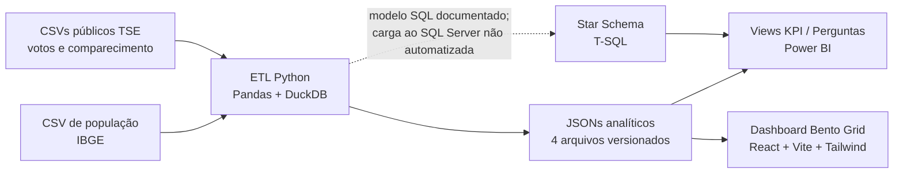

# Backstage — Inteligência Eleitoral TSE 2018–2022


**Equipe:** Backstage

**Disciplinas integradas:** *Innovation Lab: Applied BI* · *Relational Database
Programming (T-SQL)* · *Business Intelligence — 2026.2*

> Painel de inteligência eleitoral que transforma resultados presidenciais
> municipais de 2018 e 2022 em comparações territoriais, demográficas e de
> competitividade.

## Equipe

Preencha a tabela com os integrantes e revise os papéis antes da entrega:

| Integrante | RA | Função / contribuição |
|---|---|---|
| `[Nome do integrante 1]` | `[RA]` | `[Ex.: ETL e qualidade dos dados]` |
| `[Nome do integrante 2]` | `[RA]` | `[Ex.: modelagem relacional e T-SQL]` |
| `[Nome do integrante 3]` | `[RA]` | `[Ex.: Power BI e análise de negócio]` |
| `[Nome do integrante 4]` | `[RA]` | `[Ex.: dashboard React e UX]` |

## 1. O projeto em linguagem simples

### O que este projeto faz?

O Backstage compara como os votos presidenciais se distribuíram entre os
municípios brasileiros em 2018 e 2022. Em vez de apresentar apenas totais
nacionais, o painel permite filtrar por ano, turno, estado e faixa populacional,
explorar mudanças de participação eleitoral e localizar disputas apertadas.

O dashboard é uma aplicação web independente: os quatro arquivos analíticos
JSON necessários para executá-lo estão versionados em
[`dashboard/public/data/`](./dashboard/public/data/). Os CSVs brutos do TSE e
IBGE não são incluídos no Git.

### Indicadores e perguntas práticas

| Indicador | Pergunta que responde | Definição apresentada no projeto |
|---|---|---|
| **1. Swing eleitoral** | Em que direção mudou a participação da Esquerda? Quais municípios trocaram o espectro vencedor? | Diferença, em pontos percentuais, entre a participação da Esquerda nos votos válidos em 2022 e em 2018. O painel também identifica a mudança do espectro mais votado no 2º turno. |
| **2. Abstenção histórica** | A taxa de abstenção subiu ou caiu? Onde se concentram abstenções, brancos e nulos? | Abstenções divididas pelos eleitores aptos. Brancos e nulos são mostrados separadamente. |
| **3. Distribuição demográfica** | Como Esquerda, Direita e demais candidaturas se distribuem conforme o porte da cidade? | Participação nos votos válidos de municípios com `<20k`, `20k–100k` e `>100k` habitantes. A comparação usa o **1º turno**, quando as demais candidaturas estão na cédula. |
| **4. Fluxo da terceira via** | Qual foi o tamanho do ganho do vencedor no 2º turno em relação aos votos dos demais candidatos no 1º? | Ganho de votos do vencedor dividido pelos votos dos candidatos fora dos dois finalistas no primeiro turno. É uma razão territorial agregada, não uma transferência observada de pessoas. |
| **Radar de disputas** | Onde a diferença entre os dois candidatos mais votados foi menor que 3%? | Diferença de votos do primeiro e segundo colocados dividida pelo total de votos válidos no município. |

### Principais achados observados nos JSONs versionados

- **Swing nacional:** a participação da Esquerda passou de **44,8979%** em 2018
  para **50,9014%** em 2022 no 2º turno: **+6,0035 p.p.** (arredondado no
  painel para +6,00 p.p.).
- **Municípios vira-casaca:** os JSONs desta versão contabilizam **423** cidades
  em que o espectro vencedor mudou no 2º turno. Esse número não é 418; confira
  `swing_rate.swing_cities` em `resumo_nacional.json` ao atualizar a base.
- **Abstenção nacional:** no 1º turno passou de **20,1927%** para **20,7887%**
  (+0,5960 p.p.). No 2º turno passou de **21,1665%** para **20,4263%**
  (−0,7402 p.p.).
- **Voto por porte, 2022 / 1º turno:**

  | Faixa de população | Esquerda | Direita | Terceira Via / Outros |
  |---|---:|---:|---:|
  | `<20k hab` | 57,36% | 36,84% | 5,80% |
  | `20k–100k hab` | 52,46% | 40,90% | 6,64% |
  | `>100k hab` | 43,79% | 46,24% | 9,97% |

- **Taxa agregada do fluxo da terceira via:** **32,24%** em 2018 e **31,15%**
  em 2022, conforme a fórmula implementada nos dados tratados. Não representa
  rastreamento individual de votos.
- **Disputas abaixo de 3%:** a base municipal contém **197** registros em 2018
  e **274** em 2022.

> **Cuidado contra a falácia ecológica:** a abstenção é uma taxa observada no
> município, não uma característica de cada eleitor. Agrupar cidades por
> espectro majoritário ou comparar totais de turnos não permite inferir como
> uma pessoa votou, por que se absteve ou para quem transferiu seu voto.

## 2. Arquitetura técnica e engenharia

### Fluxo de dados



### Componentes

| Diretório | Responsabilidade |
|---|---|
| [`etl/`](./etl/) | Lê as bases CSV, filtra o cargo de Presidente, normaliza localidades, agrega os indicadores com DuckDB/Pandas e grava os JSONs do dashboard. |
| [`sql/`](./sql/) | DDL do modelo relacional e views T-SQL dos KPIs e perguntas analíticas. Os scripts criam esquema/consultas; não fazem a carga dos fatos. |
| [`dashboard/`](./dashboard/) | Aplicação React + TypeScript + Vite, Tailwind CSS, Recharts e Lucide. Consome os JSONs estáticos publicados em `public/data/`. |
| [`bi/`](./bi/) | Instruções para conectar um relatório Power BI às views T-SQL ou aos JSONs tratados. |
| [`dadoss/`](./dadoss/) | Local esperado para CSVs originais de entrada. Arquivos CSV são ignorados pelo Git. |

### Saídas analíticas

| Arquivo | Conteúdo |
|---|---|
| [`resumo_nacional.json`](./dashboard/public/data/resumo_nacional.json) | Totais nacionais por ano/turno, swing, abstenção, distribuição por porte e margens apertadas. |
| [`estados_kpis.json`](./dashboard/public/data/estados_kpis.json) | Indicadores estaduais, rankings de abstenção/brancos/nulos e disputas estaduais. |
| [`municipios_kpis.json`](./dashboard/public/data/municipios_kpis.json) | Agregados municipais por eleição/turno, cidades vira-casaca e disputas municipais. |
| [`terceira_via_fluxo.json`](./dashboard/public/data/terceira_via_fluxo.json) | Ganho do candidato vencedor entre turnos e razão agregada relativa aos demais candidatos do 1º turno. |

Os JSONs processados são mantidos no repositório de propósito. Assim, clonar o
projeto e iniciar o dashboard não exige obter dezenas de megabytes de CSVs.

### Cruzamento de localidades e qualidade

O ETL deriva a chave geográfica a partir de **Município + UF**: remove
diacríticos, converte para caixa alta e elimina pontuação/espaços do nome antes
do cruzamento. Para diferenças de nomes entre eleições, aplica aliases quando
há correspondência exata com a base de população e aceita correspondência
aproximada apenas quando a similaridade e a margem para o segundo candidato
atingem os limites definidos no código.

- A UF **`ZZ`** identifica localidades no exterior e fica fora dos indicadores
  municipais brasileiros.
- Localidades sem correspondência de população podem permanecer nos totais e
  rankings eleitorais, mas não entram nos recortes que exigem faixa
  populacional.
- O pipeline verifica a presença dos cinco CSVs esperados e interrompe com
  erro explícito se uma entrada obrigatória estiver ausente.

### Modelo dimensional: conceitual versus físico

O modelo lógico utilizado nos requisitos pode ser entendido assim:

| Nome conceitual | Objeto atualmente definido em `01_star_schema_ddl.sql` | Granularidade / observação |
|---|---|---|
| `ft_VotacaoCandidato` | `dbo.FatoVotos` | Uma combinação de eleição, município e candidato; contém espectro e votos. |
| `ft_DetalheVotacao` | `dbo.FatoApuracaoMunicipio` | Uma combinação de eleição e município; contém aptos, abstenções, brancos e nulos. |
| `dim_Municipio` | `dbo.DimGeografia` | Município, UF, região, população, faixa e porte. |
| Dimensão de eleição | `dbo.DimEleicao` | Ano eleitoral e turno. |
| Dimensão de espectro | `dbo.DimEspectro` | Esquerda, Direita e Terceira Via/Outros. |
| `dim_Candidato` | **Ainda não implementada como tabela separada** | `NumeroCandidato` está hoje na tabela de fatos `FatoVotos`; não trate o nome lógico como objeto já existente. |

As views ficam em [`02_kpis_analiticos_views.sql`](./sql/02_kpis_analiticos_views.sql),
com nomes como `vw_KPI_SwingRateMunicipio`,
`vw_KPI_DeltaAbstencao`, `vw_KPI_DistribuicaoDemografica`,
`vw_KPI_TaxaTransferenciaTerceiraVia` e `vw_Pergunta5_MargensApertadasMunicipio`.

> **Limite de integração SQL:** `python etl/pipeline_tse.py` gera os JSONs, mas
> atualmente não popula as tabelas T-SQL. As views precisam de uma carga de
> fatos/dimensões antes de retornarem os KPIs. Essa etapa não deve ser
> confundida com a execução local já funcional do dashboard.

### Fórmulas matemáticas

Considere `Válidos` como a soma dos votos válidos classificados nos espectros,
e use a mesma geografia e turno na comparação:

1. **Swing nacional (p.p.)**

   `100 × votos_esquerda_2022 / votos_válidos_2022 − 100 × votos_esquerda_2018 / votos_válidos_2018`

   Para o status municipal **vira-casaca**, compare o espectro com maior número
   de votos válidos em cada 2º turno; o status é verdadeiro se os vencedores
   forem diferentes.

2. **Abstenção (%)**

   `100 × abstenções / eleitores_aptos`

   A variação histórica é `taxa_2022 − taxa_2018`, em pontos percentuais.
   Brancos e nulos têm suas próprias contagens/taxas e não são somados à
   abstenção.

3. **Distribuição demográfica (%)**

   `100 × votos_do_espectro_na_faixa / votos_válidos_totais_da_faixa`

   Para observar as demais candidaturas, compare o primeiro turno.

4. **Taxa agregada da terceira via (%)**

   `100 × (votos_do_vencedor_no_2º_turno − votos_do_mesmo_candidato_no_1º_turno) / votos_de_candidatos_fora_dos_dois_finalistas_no_1º_turno`

   O valor é uma razão entre totais agregados e pode inclusive exceder 100% ou
   ser negativo em determinados recortes; não identifica transações
   individuais entre grupos de eleitores.

5. **Margem de vitória municipal (%)**

   `100 × (votos_do_1º_colocado − votos_do_2º_colocado) / votos_válidos_totais`

   O radar filtra margens estritamente menores que `3%`.

## 3. Como executar localmente — Windows PowerShell

### Requisitos

- Python **3.11 ou superior** para regenerar os JSONs.
- Node.js LTS e npm para executar/compilar a aplicação web.
- SQL Server e `sqlcmd` somente se for testar o modelo/views T-SQL.

### 3.1 Rodar o dashboard com os dados já versionados

Esse é o caminho mais curto e **não precisa de CSVs nem Python**:

```powershell
Set-Location .\dashboard
npm install
npm run dev
```

Abra o endereço impresso no terminal (por padrão
[`http://localhost:5173`](http://localhost:5173)). Para parar o servidor,
pressione `Ctrl+C`.

Para validar a compilação de produção:

```powershell
npm run build
```

### 3.2 Regenerar os JSONs pelo ETL

Os arquivos brutos são ignorados pelo Git. Obtenha as bases oficiais de votos e
comparecimento do TSE para 2018 e 2022 e a base de população utilizada pelo
projeto; coloque os cinco CSVs em `dadoss/` com estes nomes:

```text
dadoss/
  detalhe_votacao_munzona_2018_BR.csv
  detalhe_votacao_munzona_2022_BR.csv
  municipiospop.csv
  votacao_candidato_munzona_2018_BR.csv
  votacao_candidato_munzona_2022_BR.csv
```

Na raiz do repositório:

```powershell
py -3 -m venv .venv
.\.venv\Scripts\Activate.ps1
python -m pip install --upgrade pip
python -m pip install -r requirements.txt
python .\etl\pipeline_tse.py
```

O pipeline grava/atualiza os quatro arquivos em
`dashboard/public/data/`. Em seguida, rode `npm run build` em `dashboard` para
verificar o dashboard com os novos dados.

### 3.3 Criar o modelo e as views no SQL Server

Os scripts usam `dbo` no banco já selecionado. Com SQL Server LocalDB instalado,
por exemplo, abra PowerShell na raiz:

```powershell
sqlcmd -S "(localdb)\MSSQLLocalDB" -E -Q "IF DB_ID(N'dashboard_tse') IS NULL CREATE DATABASE dashboard_tse;"
sqlcmd -S "(localdb)\MSSQLLocalDB" -E -d dashboard_tse -i ".\sql\01_star_schema_ddl.sql"
sqlcmd -S "(localdb)\MSSQLLocalDB" -E -d dashboard_tse -i ".\sql\02_kpis_analiticos_views.sql"
```

Se usar outra instância, substitua `"(localdb)\MSSQLLocalDB"` pelo nome do
servidor e mantenha autenticação e banco coerentes. Os scripts criam o esquema
e as views, mas não importam os CSVs nem carregam o SQL Server. Consulte
[`bi/README.md`](./bi/README.md) para as opções de conexão do Power BI.

## Reprodutibilidade e escopo

- Os quatro JSONs são artefatos derivados versionados para execução imediata do
  dashboard.
- Os CSVs brutos de entrada e arquivos temporários/locais são ignorados em
  `.gitignore`.
- Nenhum arquivo `.pbix` ou processo automático de carga SQL é presumido como
  existente.
- Resultados podem mudar quando as bases de entrada ou regras de classificação
  forem atualizadas; confira os metadados e a data da geração ao reproduzir.
